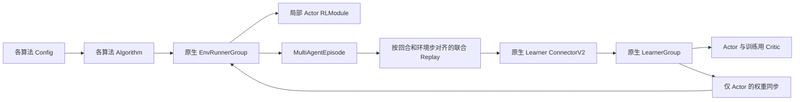

# 原生 RLlib 架构

依据当前安装的 RLlib 2.59 源码及 [官方架构](https://docs.ray.io/en/latest/rllib/key-concepts.html)。库版本 0.2。

## 职责

- **Algorithm** 调度采样、回放和学习；沿用 RLlib 的初始化、训练迭代、评估、回调和 checkpoint 生命周期。PPO 直接继承原生 PPO 运行管理。
- **EnvRunner** 创建环境并采样原生 Episode；库没有另写环境逐步采样循环，也没有独立的 Actor 副本同步。
- **RLModule** 管理可保存的网络。联合 Critic 使用 `learner_only=True` 的模块 spec；推理状态过滤训练网络和目标策略。
- **Learner** 通过 RLlib 注册优化器，先更新 Critic，再更新 Actor，最后更新目标网络。联合算法重载 `compute_losses`，ISAC 使用各模块 `compute_loss_for_module`。
- **ConnectorV2** 从原生 Episode 提取观测、下一观测和其他列。联合模块使用相同 Episode 序列，因此各 Actor 行一一对齐，训练用 Critic 不建立环境策略。
- **Replay** 以 `(episode_id, env_t, agent_id)` 构造完整联合转换。回合片段只接收本片段的新时间步，不重复加入 lookback；采样单位是整个联合转换。截断保留 bootstrap，真实终止屏蔽 bootstrap。

## 参数与训练边界

每个 Actor 参数归属自己的优化器；共享注意力、私有 Critic 编码器与头统一由唯一 Critic 优化器管理。目标网络不归属任何优化器。更新 Actor 时 Critic 参数冻结，连续策略仍能通过 Q 对动作的梯度学习。

MAAC baseline 对其他动作保持固定，连续候选使用独立采样；权重和 baseline 都停止梯度。MADDPG Actor 更新使用其他智能体的 replay 动作。MASAC/ISAC 不持有目标 Actor。

MAPPO 的 Actor 只读取 `local`，Value 读取 `critic`；IPPO 的 Actor 和 Value 都读取局部观测。PPO 连续动作保留 pre-Tanh 采样，用于计算准确的概率比，关闭重复动作缩放。

## 兼容与保存

顶层六个 Config 保留，新增对应具名 Algorithm。Tune 注册类可以从各算法包导入。六种算法都由配置提供自己的 Learner 和 RLModule 工厂。

旧算法选择开关和私有学习器接口不再兼容；旧格式 checkpoint 不迁移。新保存格式使用 RLlib 组件文件与算法额外状态保存回放、计数和 RNG。恢复后模拟器从新回合开始；直接 Learner 的固定批次续训应与保存前分支一致。

自动输出按独立运行目录隔离，默认每十次训练保存一次，保留最新两个自动 checkpoint。显式指定的路径不参与自动清理。Ray 自身的会话日志仍由 Ray 管理，详细训练结果默认不落盘。

本轮保持固定同步智能体与本地单 Learner 边界，不引入多节点训练或环境扩展。
