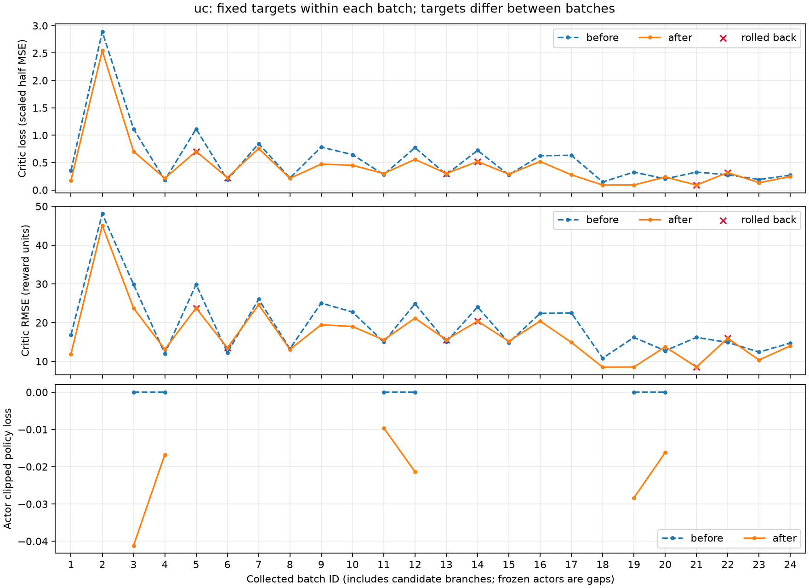
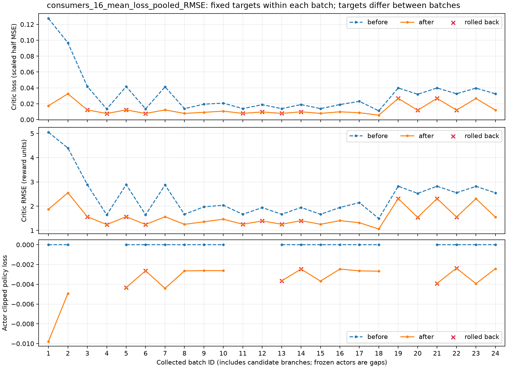

# Actor／Critic 目标分离：24 批固定预算对照

日期：2026-10-20。对照上一轮 `ea3d322` 的全部 Critic 在线更新实验。本次从相同 seed 42 初值运行一次原预算，没有续加轮数或按结果调参。测试集未加载、未评估。

**结果：UC 全月 RMSE 降低 1.58%，月初降低 12.51%，但中旬和月末分别上升 5.15% 和 0.25%；16 户消费者 RMSE 的平均值上升 22.14%。随机策略的供电率和 UC 收益改善，均值动作的供电率略降。此次没有实现所有 Critic、所有月阶段的共同改善。**

## 1. 实现与固定预算

Actor 继续使用 `lambda_gae=0.9025`，Critic 独立使用 `critic_lambda=1.0`：目标累计本批真实奖励，普通批末用采样时的旧 Value bootstrap，真实终止尾值为零。两套目标均在采样后固定。保持既有 MSE、Value 单位、六维 UC 动作、消费者动作、网络输入、环境模型、候选选择与分支隔离。实现细节见[目标分离与日志说明](BATCH_CRITIC_TARGETS.md)。

| 项目 | 上一轮 | 本次 |
|---|---:|---:|
| 初始化 | seed 42，重新初始化 | 完全相同 |
| Actor lambda | 0.9025 | 0.9025 |
| Critic lambda | 与 Actor 共用 0.9025 | 1.0 |
| 外层轮数／采样批数 | 3／24 | 3／24 |
| 每批时段／minibatch | 64／32 | 64／32 |
| Critic epoch／Actor epoch | 4／2 | 4／2 |
| 全部分支 PPO 时段 | 1,536 | 1,536 |
| 主轨迹提交时段 | 768 | 768 |
| 每个 Critic 实际优化步数 | 192 | 192 |
| 额外 MC 预拟合 | 0 | 0 |

运行前逐字段核对学习契约，除独立 `critic_lambda` 外一致；环境源码哈希与上一轮一致。训练前四个月的 5,904 状态 Critic 结果和随机／均值动作的窗口表现，与上一轮初始结果逐字段完全一致。

只加载 `train.npz` 和 `validation.npz`，测试种子为空。主轨迹为 `2010-07-01 00:00` 至 `2010-07-17 00:00`（+10:00），唯一训练时间戳 768 个；本预算未提供训练月末样本。

## 2. 验证口径

验证种子为 `10042、10045、10048、10051`，对应 2011-07、2011-10、2012-01、2012-04。Critic 使用每个月一条完整冻结随机轨迹，从每个状态计算到真实月末的折扣 MC 回报，共 5,904 个状态。月初 1—10 日 1,920 个、中旬 11—20 日 1,920 个、月末 21 日至月底 2,064 个。UC 和消费者分别报告，不合并不同奖励尺度。

供电率和 UC 收益沿用四个 96 步／48 小时窗口，分别评价随机策略和均值动作。供电率按四个窗口总失供／总请求电量计算；现金、账面利润和折扣回报取四个窗口均值。这里的供电率不是全月供电率。

各模型沿自己的策略形成状态和回报。分层 RMSE 是相同验证协议下的策略价值误差，不能把变化完全归因于固定数据集上的回归拟合。验证集也用于候选选择；本次结果没有提供测试集泛化结论。

## 3. Critic RMSE

| UC 原奖励单位 RMSE | 上一轮 | 本次 | 差值 | 相对变化 |
|---|---:|---:|---:|---:|
| 全月 | 17.7959 | 17.5153 | -0.2806 | -1.58% |
| 月初 1—10 日 | 16.1334 | 14.1151 | -2.0183 | -12.51% |
| 中旬 11—20 日 | 16.3835 | 17.2267 | +0.8432 | +5.15% |
| 月末 21 日以后 | 20.3488 | 20.3999 | +0.0511 | +0.25% |

UC 月初的平均高估从 10.8561 缩小到 8.9315；中旬平均低估从 7.1812 增至 7.5961，月末平均低估从 14.9938 增至 15.3727。全月解释方差从 0.0723 变为 0.0701，整体低估仍在；全月 RMSE 的小幅下降不代表所有拟合指标都改善。

| 16 户 RMSE 的算术平均 | 上一轮 | 本次 |
|---|---:|---:|
| 全月 | 4.4473 | 5.4321 |
| 月初 | 4.2776 | 5.5582 |
| 中旬 | 4.2248 | 5.1092 |
| 月末 | 4.7026 | 5.5402 |

16 户中仅 `consumer_1、consumer_2、consumer_4、consumer_7` 的全月 RMSE 降低。各户对照如下（箭头表示上一轮 → 本次）：

| Consumer | 全月：旧 → 新 | 月初：旧 → 新 | 中旬：旧 → 新 | 月末：旧 → 新 |
|---|---:|---:|---:|---:|
| consumer_0 | 4.0588 → 4.2639 | 3.0863 → 3.4238 | 4.4907 → 4.6996 | 4.4163 → 4.5337 |
| consumer_1 | 2.3096 → 2.1636 | 2.1406 → 1.9800 | 2.4160 → 2.2287 | 2.3594 → 2.2634 |
| consumer_2 | 4.6210 → 4.3291 | 4.4230 → 4.1884 | 5.1807 → 4.8451 | 4.2327 → 3.9309 |
| consumer_3 | 4.7257 → 6.7199 | 4.3383 → 6.9828 | 4.8863 → 6.7862 | 4.9155 → 6.4012 |
| consumer_4 | 5.7899 → 5.6511 | 5.4321 → 5.5187 | 5.3054 → 5.1206 | 6.5005 → 6.2149 |
| consumer_5 | 7.3522 → 10.2293 | 6.9742 → 9.9885 | 6.8374 → 9.5999 | 8.1171 → 10.9898 |
| consumer_6 | 3.7989 → 4.9521 | 3.8629 → 5.1033 | 3.5442 → 4.8188 | 3.9642 → 4.9315 |
| consumer_7 | 4.4332 → 4.0651 | 5.0051 → 4.3248 | 3.6887 → 3.5345 | 4.5008 → 4.2719 |
| consumer_8 | 2.4272 → 2.5149 | 1.4898 → 2.8318 | 2.2080 → 1.8830 | 3.2018 → 2.7080 |
| consumer_9 | 5.6919 → 9.0331 | 6.2966 → 9.8224 | 3.8430 → 7.4086 | 6.4849 → 9.6229 |
| consumer_10 | 5.3983 → 7.2556 | 5.0833 → 7.8799 | 6.1556 → 7.4659 | 4.9065 → 6.4011 |
| consumer_11 | 3.5325 → 4.3713 | 3.7767 → 4.6674 | 3.4114 → 4.2266 | 3.4058 → 4.2162 |
| consumer_12 | 5.3614 → 5.8396 | 4.8510 → 5.5527 | 3.9327 → 4.2635 | 6.7783 → 7.2078 |
| consumer_13 | 1.9810 → 3.8992 | 1.9386 → 4.2587 | 1.9328 → 3.7182 | 2.0625 → 3.7091 |
| consumer_14 | 4.4260 → 4.9962 | 4.9827 → 5.6776 | 3.8323 → 4.2803 | 4.3907 → 4.9369 |
| consumer_15 | 5.2500 → 6.6303 | 4.7597 → 6.7303 | 5.9309 → 6.8676 | 5.0046 → 6.3037 |

消费者误差恶化有明确的偏差证据。例如 `consumer_9` 的验证平均回报几乎不变（-16.0447 → -16.0333），但平均预测从 -20.4331 降至 -24.2914，平均误差从 -4.3885 扩大至 -8.2581。`consumer_5` 的平均回报为 -7.6034 → -7.6213，平均预测为 -13.5090 → -16.9250。它们对当前训练批的拟合可以改善，同时在完整验证月上更加低估。

结合代码可以确认：`critic_lambda=1` 减少了批内中间旧预测的混入，但批末仍 bootstrap，训练仍只覆盖月前半段。更长的实际回报目标会改变拟合方向、方差和后续优势；本次观察到消费者低估扩大，不能仅凭这一次运行分离出目标方差、数据分布和策略响应各自的贡献。

## 4. 供电率与 UC 收益

现金和账面利润的单位为 AUD／48 小时；失供电量为四个窗口总和。

| 指标 | 随机：上一轮 | 随机：本次 | 均值动作：上一轮 | 均值动作：本次 |
|---|---:|---:|---:|---:|
| 原生供电率 | 99.6316% | 99.7279% | 99.8905% | 99.8865% |
| 绝对失供量（kWh） | 6.2080 | 4.5777 | 1.8757 | 1.9437 |
| UC 现金收益 | 33.3142 | 35.3490 | 35.6625 | 35.9914 |
| UC 账面利润 | 20.5573 | 22.6773 | 23.2645 | 23.5792 |
| UC 折扣回报 | 5.2404 | 6.5484 | 7.7051 | 7.9997 |

随机策略供电率提高 0.09623 个百分点，绝对失供减少 1.6303 kWh，UC 现金收益增加 2.0348 AUD／48 小时。均值动作供电率下降 0.00394 个百分点，失供增加 0.0680 kWh，现金收益增加 0.3289 AUD／48 小时。这个结果支持随机验证窗口上的收益和供电改善，同时保留均值动作下的轻微退化事实。

候选选择从上一轮 `1、0、1` 变为 `1、1、1`。因此最终 checkpoint 保留的 UC Actor／Value Adam 步数从 `16／128` 变为 `24／144`，消费者仍为 `48／96`。这些保留历史都来自同一 24 批执行预算。候选仍按原 UC 配对收益规则选择，没有新增供电率接受检查。

## 5. 横轴 1—24 的真实 loss 曲线

日志包含全部 24 批、408 条模块测量，另有 18 条分支决议事件。每轮依次为消费者适应 2 批、UC 提案 2 批、候选 0 响应 2 批、候选 1 响应 2 批。回滚不删除记录，也不重置编号。

蓝线为本批更新前，橙线为更新后；两者使用同一完整批、同一固定目标。叉号表示该网络更新被回滚。Actor 冻结处留空。Critic loss 为固定尺度下的半 MSE，RMSE 还原为原奖励单位；Actor loss 为 PPO clipped surrogate，不含熵项。





消费者汇总图对 loss 取 16 户均值，RMSE 为相同样本数下合并平方误差后的根值，Actor loss 在全部消费者实际更新时取均值。逐户曲线均另行生成，原始数值保存在日志和 CSV 中。

UC 有 17／24 批的固定目标 loss 下降，7 批上升（4、6、11、13、15、20、22）；消费者各自为 17—24 批下降。UC 第 1 批更新后 loss 为 0.1762，第 24 批为 0.2449，不能仅挑选第 2 批高点宣称收敛。批间目标、物理状态、策略和候选分支不同，曲线展示实际更新过程，不是同一固定数据集上的单调收敛证明。

## 6. 检查、文件与复现

本次真实运行完成 5,352 次冻结优化器检查；批次预算、每个 Critic 的 192 次实际更新、Actor 空值和 24 个连续编号均核验通过。检查点恢复后的 8 步轨迹逐字段一致。初始／最终验证各 6,672 个物理时段（完整月 5,904，加两类短窗口 768）；候选验证 2,304 个时段；另有 16 个只用于回放检查且随后恢复的时段，均未进入参数更新。

Actor GAE 残差最大 `2.84e-14`，Critic 目标独立复核残差最大 `7.11e-14`；功率、队列和现金残差分别不超过 `7.11e-15、5.45e-15、3.55e-15`。环境源码与历史基线及运行前哈希一致。

目标与日志实现已通过 329 项批量回归，随后 4 项针对性复核和 5 项原生 Ray 集成检查（这些检查存在重复覆盖）；本轮入口和汇总脚本通过 Ruff、契约核对、同一报告自比较零差值检查及真实运行验证。PNG／SVG 已渲染检查。没有运行 GPU 训练，也没有追加参数搜索。

- [机器可读对照、来源哈希与逐户分层统计](results/batch_critic_20261020/comparison.json)
- [真实逐批原始 JSONL](results/batch_critic_20261020/batch_losses.jsonl)
- [408 条模块测量 CSV](results/batch_critic_20261020/batch_losses.csv)
- [UC 矢量曲线](results/batch_critic_20261020/plots/batch-loss-uc.svg)
- [消费者汇总矢量曲线](results/batch_critic_20261020/plots/batch-loss-consumers_16_mean_loss_pooled_RMSE.svg)

完整本地结果为 `outputs/ausgrid-batch-critic-pilot/20261020/`，含原报告、逐轮结果、优化器审计、checkpoint、Actor 导出和 `analysis/plots/` 下 17 个网络及消费者汇总的 PNG／SVG。原始数据、模型与运行输出继续由 Git 忽略；提交源码、测试、报告及精简可复核证据。历史结果保持完整。

固定预算入口（已有结果目录时拒绝覆盖）：

```powershell
.\.venv\Scripts\python.exe -u -B experiments/sn_energy_market/batch_critic_pilot.py
```

仅汇总和绘图，需使用装有 Matplotlib 的 Python，不启动训练：

```powershell
python experiments/sn_energy_market/summarize_batch_critic.py outputs/ausgrid-batch-critic-pilot/20261020/report.json --output outputs/ausgrid-batch-critic-pilot/20261020/analysis
python experiments/sn_energy_market/plot_batch_losses.py experiments/sn_energy_market/results/batch_critic_20261020/batch_losses.jsonl --output outputs/batch-loss-replot
```
