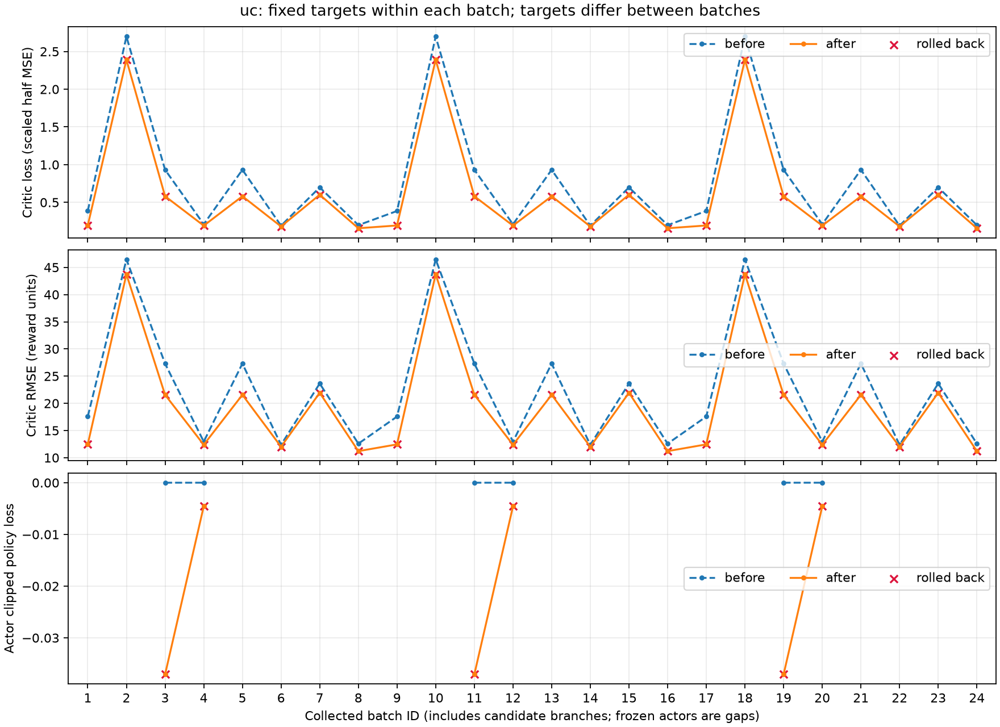
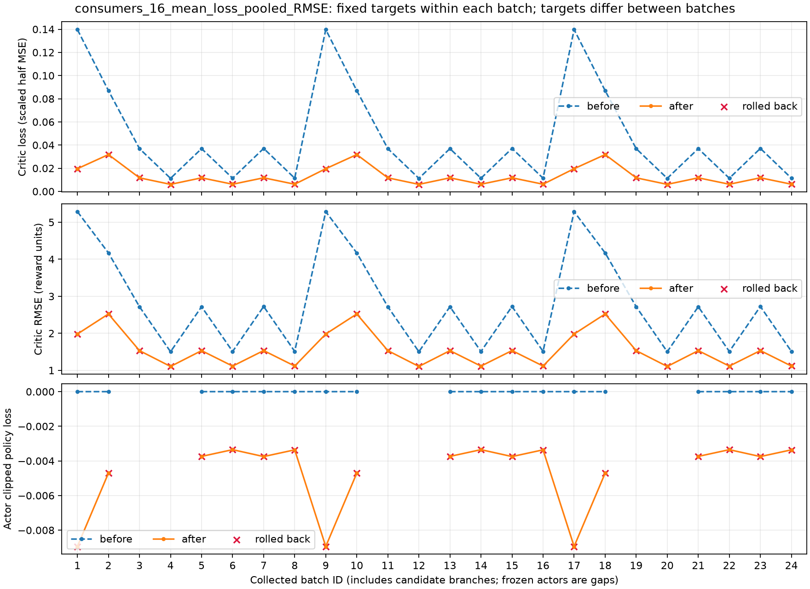

# Critic LayerNorm、UC 时间支路与供电／现金筛选：24 批对照

日期：2026-10-20。seed 42 下总共执行 3 次外层尝试、24 批，未追加训练，测试集未加载或评估。

**本次没有得到可保留的训练改进：三个外层轮次全部拒绝，Actor、Critic、Adam 和主轨迹均恢复初态。最终冻结验证与新结构训练前逐字段完全一致，UC 全月 RMSE 为 35.1674，消费者平均为 8.7431，均高于旧三轮基线。**

两个候选的失供和现金都退化，约束按要求阻止了提交；但完整状态与 RNG 一起回滚，使后两轮重复同一尝试，Critic 的批内改善也被丢弃。最终供电和现金就是原始 Actor 的表现，不能归功于此次训练。这组结果不能单独判断 LayerNorm 或时间支路的学习收益。

## 实现与比较口径

全部 Critic 的两层隐藏层加入 LayerNorm；UC Value 增加已有时间观测派生的四维线性支路，权重零初始化。Actor 网络和初始参数、六维 UC／四维消费者动作、环境源码、奖励、Value 单位及 MSE 均保持。每批 64 步、Critic 4 epoch、Actor 2 epoch、minibatch 32，Actor λ=0.9025、Critic λ=1.0，零额外 MC 预拟合。

候选 0 和新候选都与轮初已提交联合策略比较：四个匹配验证窗口的汇总失供比例、失供量不增加，UC 现金不减少，数值容差为 1e-9；然后沿用相对候选 0 的配对 UC 折扣回报规则。全拒绝时恢复轮初网络、Adam、环境和 RNG，消耗预算与日志编号保留，不补跑。能源指标由实验回调处理。

直接基线为修改前的三轮结果。其 72 轮复现实验的第 3 轮与小规模基线精确一致，因此复用该节点的完整月能源指标，没有重新评价旧策略。验证为 2011-07、2011-10、2012-01、2012-04：每月从月初冻结运行至真实月末，共 5,904 个状态；另列四个 48 小时窗口。新旧策略生成的轨迹不同，RMSE 是各自策略下的价值拟合误差。

## 实际预算与候选

- 实际执行 24 批、1,536 个 PPO 时段，每个 Critic 执行 192 次 Adam 优化。
- 主轨迹保留 0 步，终点为训练月初 `2010-07-01T00:00:00+10:00`。
- 实际训练覆盖 256 个不同日历时段；分支和拒绝后的尝试重复采样，未获得训练月中／月末覆盖。
- 三轮选择：`[null, null, null]`；`null` 表示整轮回滚。
- 初始 Actor 的实际回报、能源和现金指标与基线逐字段相同；Critic 结构已变，训练前误差单列。
- 第一轮全拒绝并完成回滚后，新增候选日志中的 NumPy 布尔值触发 JSON 序列化错误。修复为原生标量后，依据 8 条回滚记录重建 seed 42 初态，只执行预算内剩余 16 批。第 9–16、17–24 批的全部逐批诊断与第 1–8 批逐字段一致，验证重建与重复尝试。原失败日志、初始验证和恢复来源哈希保留；未重跑第一轮。
- 第一轮候选检查详细数值在序列化时丢失，下表仅列实际保存的第 2、3 轮检查；第一轮全拒绝结论由 8 条分支决议确认。第一轮每次 Adam 参数变化量未落盘，保留其逐批梯度列表和聚合 Adam 审计，不伪造缺失记录。

| 轮／候选 | 失供比例变化（百分点） | 失供量变化 kWh | 现金变化 AUD | 检查通过 | 配对 UC 差下界 |
|---|---:|---:|---:|---|---:|
| 2 / 0 | +0.118549 | +1.992968 | -3.292337 | 否 | +0.000000 |
| 2 / 1 | +0.135223 | +2.273839 | -3.022344 | 否 | -0.092843 |
| 3 / 0 | +0.118549 | +1.992968 | -3.292337 | 否 | +0.000000 |
| 3 / 1 | +0.135223 | +2.273839 | -3.022344 | 否 | -0.092843 |

## UC Critic RMSE

| 日期 | 旧算法三轮 | 新结构训练前 | 新算法三轮 | 相对旧三轮 |
|---|---:|---:|---:|---:|
| 月初 1–10 日 | 14.1151 | 18.0651 | 18.0651 | +27.98% |
| 中旬 11–20 日 | 17.2267 | 36.1762 | 36.1762 | +110.00% |
| 月末 21 日起 | 20.3999 | 44.9075 | 44.9075 | +120.14% |
| 全月 | 17.5153 | 35.1674 | 35.1674 | +100.78% |

## 16 户消费者 RMSE 算术平均

| 日期 | 旧算法三轮 | 新结构训练前 | 新算法三轮 | 相对旧三轮 |
|---|---:|---:|---:|---:|
| 月初 1–10 日 | 5.5582 | 7.7812 | 7.7812 | +40.00% |
| 中旬 11–20 日 | 5.1092 | 9.1922 | 9.1922 | +79.91% |
| 月末 21 日起 | 5.5402 | 9.0277 | 9.0277 | +62.95% |
| 全月 | 5.4321 | 8.7431 | 8.7431 | +60.95% |

16 户中有 5 户全月 RMSE 降低。逐户、分日期的 RMSE、偏差和解释方差保存在机器摘要中。

## 供电和 UC 收益

| 口径／指标 | 旧算法三轮 | 新算法三轮 |
|---|---:|---:|
| 48 小时随机策略：供电率 % | 99.727855 | 99.771911 |
| 48 小时随机策略：四窗口总失供 kWh | 4.577657 | 3.845671 |
| 48 小时随机策略：UC 现金 AUD/48h | 35.349010 | 32.524306 |
| 48 小时随机策略：UC 折扣回报 | 6.548403 | 4.758361 |
| 48 小时均值动作：供电率 % | 99.886540 | 99.883928 |
| 48 小时均值动作：四窗口总失供 kWh | 1.943739 | 1.992757 |
| 48 小时均值动作：UC 现金 AUD/48h | 35.991392 | 33.695330 |
| 48 小时均值动作：UC 折扣回报 | 7.999652 | 6.735193 |
| 完整月供电率 % | 99.105065 | 99.160446 |
| 四个月总失供 kWh | 234.288046 | 220.055401 |
| 完整月 UC 现金 AUD/日 | 38.286422 | 38.310724 |
| 完整月 UC 账面收益 AUD/日 | 32.974590 | 32.950420 |

检查基准是上一轮已提交策略，不能将它解释为优于旧算法三轮结果的保证。筛选窗口的经验约束也不能保证完整月或测试集供电／现金不退化。

## 真实逐批 loss 与诊断

横轴直接使用 1–24，未按 epoch 聚合。每点为同一固定目标上的整批更新前／后测量；回滚分支用叉号标出，冻结 Actor 留空。目标随批次变化，批内 loss 下降不能称为收敛。

逐批日志已记录预测、目标、实际奖励回报与 bootstrap 的均值／标准差／范围、两层 Tanh 饱和比例、裁剪前梯度范数和环境指标。目标分解及更新前后固定性核对通过，未额外采样或改动 RNG。

UC 的 24 批 loss 均在批内降低；15 户消费者为 24 批降低，另一户为 21 批降低。更新后两层 Tanh 平均饱和比例：UC 为 0.0061%／0.0122%，消费者为 0%／0.1953%。这些是被回滚分支上的诊断，不能替代最终验证。UC 裁剪前最大梯度范数约 8.0991，裁剪阈值仍为 0.5。

最终 UC 时间支路权重：`[0.0, 0.0, 0.0, 0.0]`。

## 验收与证据

125 项相关单元／Ray CPU 集成检查通过，涵盖冻结 Adam、候选公共起点、整轮拒绝恢复、不回退预算与日志编号、Actor 初始化一致和 checkpoint；CUDA 检查未运行。序列化修复后另通过 18 项相关检查。正式实验的 checkpoint 8 步逐字段精确重放通过，环境生产源码哈希不变。

- [机器摘要与逐户日期对比](results/critic_stability_20261020/comparison.json)
- [24 批完整诊断日志](results/critic_stability_20261020/batch_losses.jsonl)
- [逐批 loss 数值](results/critic_stability_20261020/batch_losses.csv)
- 完整原始输出、优化器审计、checkpoint 和 Actor：`outputs/ausgrid-critic-stability-pilot/20261020/`。
- [训练协议](TRAINING.md)；[建模阅读版](../../environments/sn_energy_market/docs/v9/modeling_complete_zh.html)。
