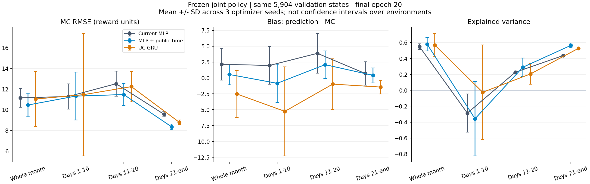
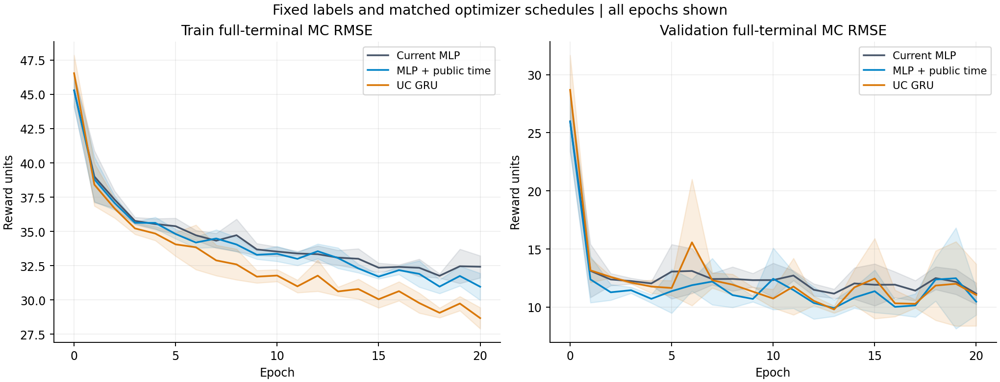

# 冻结联合策略的 UC Critic 三组对照

日期：2026-10-21。原始证据：`outputs/ausgrid-frozen-critic/20261021/`。完整数值见 [comparison.json](results/frozen_critic_20261021/comparison.json)，逐日期结果见 [per-date-summary.csv](results/frozen_critic_20261021/per-date-summary.csv)。

本次优先推荐继续检验 **MLP + 公共时间编码**。同轨迹、同 MC 标签、同优化预算下，其全月验证 RMSE 为 **10.467 ± 1.144**，较当前结构 MLP 的 **11.162 ± 0.920** 下降 **6.23%**。中旬和月末改善，月初没有改善。仅 UC Critic 加 GRU 的平均 RMSE 为 **11.044 ± 2.660**，种子波动明显更大，目前不支持直接替换在线 Critic。

以上均为预先固定的第 20 epoch 结果，± 表示三个拟合种子的样本标准差。它衡量同一数据上的初始化与优化顺序敏感性，不是环境泛化置信区间。本次没有按验证结果挑选最佳 epoch 或种子。

## 实验对象与控制条件

冻结来源为 `outputs/ausgrid-layernorm-pilot/20261020/actors/actors.pt`，与同目录 checkpoint 的全部 17 个 Actor 参数逐项一致。来源 Git HEAD 为 `2dd12cf`；启动时已有的 `algorithm.py` 注释改动保持原样，并纳入源码哈希。

| 项目 | 本次固定值 |
|---|---|
| 联合策略 | 最新 LayerNorm 三轮实验导出的 UC 和 16 户消费者 Actor，按原随机策略采样 |
| 环境、物理、观测、动作、奖励 | 沿用来源 checkpoint 的场景契约；三组读取同一批存档轨迹 |
| 训练数据 | 2010-07 至 2011-06，共 12 个真实完整月、17,520 个 UC 状态，采样种子 42–53 |
| 验证数据 | 2011-07、2011-10、2012-01、2012-04，共 5,904 个 UC 状态，种子 10042、10045、10048、10051 |
| 轨迹数量 | 每月一个冻结随机联合策略轨迹；每个轨迹只采一次，供全部模型复用 |
| MC 标签 | γ=0.9801，从当前期到真实月末的完整折扣奖励；月末尾值为零，无批末 bootstrap |
| 拟合种子 | 11、29、47；共 3 组 × 3 种子 = 9 次拟合 |
| 更新预算 | 每次 20 epoch、1,380 次 Adam 更新、350,400 个有效标签使用次数 |
| 批次 | 32 步连续片段，每个 minibatch 至多 8 段；每个 epoch 每个训练标签恰好使用一次 |
| 优化器 | Adam，lr=0.001，梯度范数裁剪 0.5，固定 Value 输出尺度 20 |
| 损失 | `0.5 * 0.5 * mean(((prediction - MC) / 20)^2)`，padding 不参与损失 |
| 配对方式 | 同种子的三组共享片段顺序哈希、标签、公共编码器和输出头初始参数 |
| 运行环境 | CPU 单线程，Torch 2.14.1+cu130，确定性模式 |
| 测试集 | 未加载、未评估 |

三组都从新的配对 Value 初始化开始拟合；“当前 MLP”指当前生产网络结构。来源 checkpoint 的旧 Value 另列为零更新参考，没有把它与另外两组的新网络混作等预算对照。

训练和验证使用不同年份。四个验证月此前参与过在线候选选择，因此这是 Critic 的开发验证集；最终独立算法评价仍需保留测试集。三个拟合种子共用冻结 Actor 和轨迹，不能替代三个策略训练种子或多个随机环境实现。

## 三个 UC Value 模型

| 模型 | 输入与结构 | 参数量 |
|---|---|---:|
| 当前 MLP | 68 维 UC 当前观测；signed-log 输入；两层 `Linear(32) → LayerNorm → Tanh`；标量头 | 3,425 |
| MLP + 公共时间 | 同上，附加 8 维已知公共时间；新增输入列权重从零开始 | 3,681 |
| 仅 UC Critic 加 GRU | 相同 68 维观测编码器后接 32 维 GRU，再接相同标量头 | 9,761 |

公共时间包含：月内已过比例、剩余期数/1488、小时 sin/cos、星期 sin/cos、月份 sin/cos。这些特征均在 UC 行动前生成，只传给离线 Critic；不包含未来价格、未来负荷、未来奖励或消费者私有状态。

GRU 读取原有 UC 观测的历史，不额外增加历史动作或奖励字段。训练每个片段前，使用当前网络参数从该真实月份起点重放前缀，得到无梯度 hidden；仅对随后 32 步做 BPTT。前缀不计算损失，不额外使用 MC 标签。每个模型共重放 7,928,320 个前缀观测。评价时 hidden 在月内连续传递，在真实月初清零。

这保证的是相同标签和优化步数，不是相同参数量或计算量。GRU 参数约为 MLP 的 2.85 倍；若未来观察到收益，还需等参数 MLP 对照才能将收益归因于记忆。

## 分日期验证结果

偏差定义为 `prediction - MC`，正数表示高估。解释方差为 `1 - Var(prediction - MC) / Var(MC)`，与包含偏差惩罚的 R² 不同。月初、中旬、月末分别含 1,920、1,920、2,064 个状态。全月指标先合并 5,904 个状态计算，再对三个模型种子求均值；没有对预测做集成。

**RMSE，奖励原单位，越小越好：**

| 日期范围 | 当前 MLP | MLP + 公共时间 | UC GRU |
|---|---:|---:|---:|
| 全月 | 11.162 ± 0.920 | **10.467 ± 1.144** | 11.044 ± 2.660 |
| 1–10 日 | **11.290 ± 1.230** | 11.331 ± 2.314 | 11.469 ± 5.934 |
| 11–20 日 | 12.526 ± 1.221 | **11.479 ± 1.066** | 12.246 ± 1.466 |
| 21 日至月末 | 9.569 ± 0.241 | **8.353 ± 0.267** | 8.794 ± 0.218 |

**偏差，越接近零越好：**

| 日期范围 | 当前 MLP | MLP + 公共时间 | UC GRU |
|---|---:|---:|---:|
| 全月 | +2.147 ± 2.496 | +0.550 ± 1.608 | −2.528 ± 3.690 |
| 1–10 日 | +1.970 ± 2.975 | −0.844 ± 3.010 | −5.262 ± 7.017 |
| 11–20 日 | +3.878 ± 3.142 | +2.095 ± 2.173 | −0.968 ± 4.003 |
| 21 日至月末 | +0.700 ± 1.848 | +0.410 ± 1.178 | −1.436 ± 1.070 |

**解释方差，越大越好：**

| 日期范围 | 当前 MLP | MLP + 公共时间 | UC GRU |
|---|---:|---:|---:|
| 全月 | 0.549 ± 0.036 | 0.580 ± 0.084 | 0.569 ± 0.147 |
| 1–10 日 | −0.286 ± 0.240 | −0.357 ± 0.467 | −0.024 ± 0.594 |
| 11–20 日 | 0.227 ± 0.018 | 0.291 ± 0.116 | 0.207 ± 0.130 |
| 21 日至月末 | 0.437 ± 0.018 | 0.564 ± 0.030 | 0.528 ± 0.006 |



公共时间使中旬、月末 RMSE 分别下降 8.36%、12.71%，但月初 RMSE 增加 0.36%。月初平均偏差更接近零，不代表组内状态区分能力改善：其解释方差仍为负。全月 EV 较高，也不能替代日期分层检查。

除上述分层外，已保存全部 **123 个实际日期** 的 RMSE、偏差与解释方差：[逐模型逐日 CSV](results/frozen_critic_20261021/per-date-metrics.csv) 共 1,107 行，[逐日三种子汇总](results/frozen_critic_20261021/per-date-summary.csv) 共 369 行。每日仅有 48 个相关状态，单日 EV 对标签方差很敏感，宜结合日期分层结果阅读。

## 种子、月份与拟合过程

| 拟合种子 | 当前 MLP 全月 RMSE | 公共时间全月 RMSE | UC GRU 全月 RMSE |
|---|---:|---:|---:|
| 11 | 12.207 | 11.078 | 9.408 |
| 29 | 10.801 | 9.147 | 9.611 |
| 47 | 10.477 | 11.175 | 14.113 |

公共时间在三个配对种子中的两个优于 MLP；其均值优势是继续试验的依据，还不能称为显著、稳定的泛化优势。GRU 的种子 47 在月初出现 −13.340 的偏差、18.319 的 RMSE，拉大了总体波动。保留该次结果，不以较早 epoch 替换。

| 验证月份 | 当前 MLP RMSE | 公共时间 RMSE | UC GRU RMSE |
|---|---:|---:|---:|
| 2011-07 | 16.636 ± 1.314 | 15.278 ± 1.080 | 16.382 ± 2.530 |
| 2011-10 | 8.606 ± 1.614 | 6.550 ± 1.011 | 9.070 ± 2.700 |
| 2012-01 | 9.038 ± 1.236 | 9.951 ± 1.617 | 9.656 ± 4.116 |
| 2012-04 | 7.715 ± 1.996 | 7.748 ± 1.519 | 6.139 ± 1.726 |

公共时间的收益主要出现在 7 月和 10 月；1 月变差，4 月接近持平。不能只根据全月合并指标认为各季节都已改善。[分月图](results/frozen_critic_20261021/per-month-rmse.png) 保留该差异。



训练集全月 RMSE 依次为 32.423、30.963、28.673。GRU 更能拟合训练数据，但验证曲线存在明显波动，并未形成稳定优势。每次拟合及逐 epoch 评价的实际耗时中位数分别为 2.03、2.25、47.50 秒；这是本机单线程观测值，包含评价和前缀重放、受首次运行开销影响，不是严格性能基准。

训练集存在一个明显的尾部问题：2011-02 的 MC 标准差为 127.224，最小值为 −582.154，出现在 2011-02-05 15:30。训练集 268 个低于 −100 的标签中，243 个来自该月。该月只占训练状态的 7.67%，却分别占 MLP、公共时间、GRU 最终训练平方误差的约 83.34%、87.77%、81.13%（各种子占比再平均）。这解释了为什么训练 RMSE 远高于验证 RMSE，也提示总训练损失主要受少数日期影响。

三组更新触发梯度裁剪的比例分别为 97.20%、96.71%、93.74%。这些事实支持进一步检验优化尺度与尾部敏感性；本次尚未识别该尾部对应的具体物理或结算原因，不能把它直接判为错误数据，也未删除、截断或改写标签。

## 与旧 checkpoint 的关系

旧 checkpoint 在同一验证轨迹上的全月 RMSE 为 16.129，月初为 19.856；此次用原 Actor 和采样种子精确复现其原始验证统计，最大差值为 **0**。旧 Value 全月偏差为 +3.199，解释方差为 0.032。仅用训练标签均值作常数预测的全月 RMSE 为 17.135、EV 为 0。

相同 MLP 结构经此次完整训练月、终止 MC 标签和统一离线预算后达到 11.162，说明现有网络并非只能达到旧 checkpoint 的误差水平。由于数据覆盖、标签和训练预算一起改变，这不能单独归因于去除 bootstrap，也不能直接推出线上只增加 Critic epoch 就能获得同样收益。

## 下一步建议

1. **将公共时间方案作为下一轮候选，先解决月初与优化稳定性。** 保持这批冻结数据，单独对照当前 lr=1e-3 与 lr=3e-4；仍使用相同更新次数、相同三个配对种子和完整标签，检查月初 EV、各日期偏差、2011-02 误差占比和末期波动。学习率调整是待检验假设，不在此次结果中回填收益。若引入自适应 Value 尺度，另开独立 [PopArt](https://arxiv.org/abs/1602.07714) 对照，不与改网络、改奖励同时实施；PopArt 也不会自动消除重尾 MSE 的影响。
2. **补充冻结策略的轨迹重复，区分表示不足与 MC 随机噪声。** 下一阶段每个训练、验证月使用多个动作随机数种子，三种结构仍共享同一数据；保持优化预算可比，并按月份/整条轨迹汇总不确定性。当前只有每月一条实现，不能把剩余 RMSE 全部视为网络可消除的拟合误差，也不能把相邻状态当独立样本做显著性检验。
3. **随后只把 UC 公共时间输入作为在线结构变量。** 以当前生产 MLP 为对照，固定训练时段、月份覆盖、候选规则和初始 Actor，运行至少三个策略训练种子；训练中允许 Actor 按原算法更新，比较完整月 UC 收益、现金、供电率、失供及消费者指标，同时跟踪 MC RMSE、日期偏差和 EV。以这些策略指标决定是否保留，不能把这次冻结 Critic 的拟合收益等同于算法收益。
4. **GRU 暂缓进入生产训练链。** 若优化稳定化和多轨迹复核后仍有稳定收益，再做等参数 MLP 对照，确认是否需要历史；正式接入还要覆盖在线序列训练、hidden 跨批传递、月末重置、候选分支隔离和 checkpoint 重放。本次离线前缀重放没有自动完成这些在线改造。

本次联合 Actor 冻结，三组共享环境行动与奖励，因此供电、现金、收益等策略指标不会因三个离线 Critic 的拟合而改变。当前已完成的是价值估计对照与下一步选择依据。

## 验证与复现

- Actor 导出与来源 checkpoint 参数逐项一致；采样前后 Actor 参数哈希一致。
- 16 个月数据文件哈希、真实终止、MC 一步恒等式、独立折扣求和均通过；独立 MC 求和最大差值 `1.71e-13`。
- 9 个模型的 Adam 状态均为 1,380 步，标签使用次数均为 350,400；同种子三组的完整片段顺序哈希相同。
- 9 个模型保存后重新加载，验证预测逐元素精确一致；独立重算训练/验证分日期指标，最大差值 `1.42e-14`。
- 实验结束后来源 Actor 文件、环境与算法源码哈希保持；详细检查见 [postrun_audit.json](results/frozen_critic_20261021/postrun_audit.json)。
- 新增 6 项测试覆盖公共时钟、配对初始化、GRU 因果性与重置、前缀刷新、片段覆盖与 padding、MC 标签；连同原有 10 项策略测试，**16 项通过**。相关 Python 文件 Ruff 通过；三幅 PNG 已逐幅检查。

入口分别是 [实验脚本](frozen_critic_ablation.py)、[离线 Value 模型](../../RLAlgo/src/raymarl/algorithms/stackelberg/critic_probe.py)、[独立审计](audit_frozen_critic.py)、[绘图与 CSV 导出](plot_frozen_critic.py)。生产 PPO 未切换到这些离线模型。

从仓库根目录执行；完整重跑请使用新的输出目录，避免覆盖此次数据：

```powershell
$env:PYTHONUTF8='1'
.\.venv\Scripts\python.exe -B experiments/sn_energy_market/frozen_critic_ablation.py --output outputs/ausgrid-frozen-critic/reproduction
.\.venv\Scripts\python.exe -B experiments/sn_energy_market/audit_frozen_critic.py outputs/ausgrid-frozen-critic/reproduction
.\.venv-plots\Scripts\python.exe experiments/sn_energy_market/plot_frozen_critic.py outputs/ausgrid-frozen-critic/reproduction --output outputs/ausgrid-frozen-critic/reproduction/plots
```

原始目录保留 `protocol.json`、`data_manifest.json`、16 个轨迹 NPZ、9 套 checkpoint/Adam/学习曲线/验证预测及 `report.json`。已有实验可仅执行审计与绘图，无需重新采样或训练。
