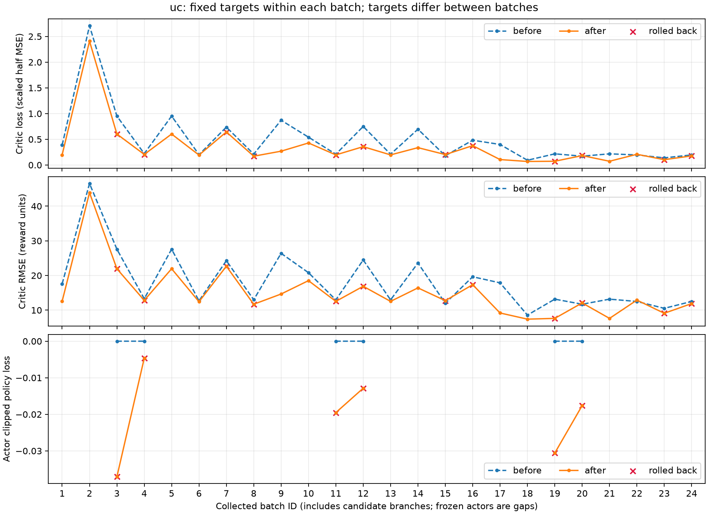
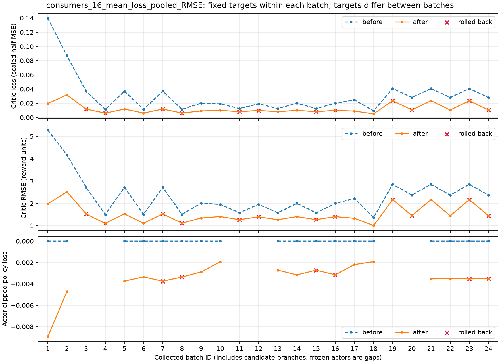

# 仅保留 Critic LayerNorm：三轮短测与后续算法判断

2026-10-20。只执行一次 seed 42、3 轮 24 批短测，测试集未加载、未评估。

## 回退范围

保留全部 Critic 的两层 LayerNorm，以及预测／目标／实际回报／bootstrap 分布、Tanh 饱和比例、梯度和能源诊断。完整删除 UC 时间支路、相关配置与参数、供电／现金可行性回调、轮初评价缓存、整轮全拒绝恢复路径及对应测试。原有时间观测仍进入普通网络，环境与动作不变。

候选仍为旧 UC 和新 UC，分别从公共消费者／Adam／环境／RNG 起点训练响应；按既有配对 UC 折扣收益规则选择，新候选不合格时提交候选 0。没有加入首批 Critic 保留方案，也没有加入 GRU。

本次每轮的 8 批仍按下表执行。U、C 只表示 Actor；星号表示两批有限适应的结果，不表示已求得最优响应或纳什均衡。

| 批次 | 固定 Actor | 更新 Actor | 完成后的作用 |
|---|---|---|---|
| 1–2 | U₀ | C₀ → C_A | 保存公共网络、Adam、环境和 RNG |
| 3–4 | C_A | U₀ → U₁ | 保存新 UC 提案 |
| 5–6 | U₀ | C_A → C₀* | 公共起点重新响应，形成候选 0 |
| 7–8 | U₁ | C_A → C₁* | 同一公共消费者／环境／RNG 起点响应，形成候选 1 |

每批都更新全部 Critic。候选 1 保留提案后的 UC Actor、Critic 和两套 Adam，但消费者网络及其 Adam 恢复公共起点；提案的物理推进被丢弃。最终保留前置适应和所选响应分支，未选分支不混入另一分支。选择候选 0 仍保留消费者及 Critic 学习，下一轮从该分支终点继续。

直接对照是不加 LayerNorm 的旧三轮基线；上次全回滚结果单列，不能用它代替已训练基线。全部从 seed 42 初始化，初始 Actor 的动作回报与能源指标逐字段一致，Critic 架构不同。RMSE 在各自策略的冻结验证轨迹上衡量，不是同一固定轨迹上的纯回归比较。

## 预算及验证

- 24 批 × 64 步 = 1,536 个 PPO 分支时段；主轨迹推进 768 步，唯一训练日历时段 768 个。
- 候选选择 [0, 0, 0]；训练批中的真实月末终止次数为 0。短测只覆盖训练月前 16 天，不能验证第 329 批或训练月末稳定性。
- 每个 Critic 实际执行 192 次 Adam；分支保留次数见机器摘要。Actor 2 epoch、Critic 4 epoch、minibatch 32、Actor λ=0.9025、Critic λ=1.0 均保持；额外 MC 训练为零。
- 旧基线最终 UC Actor／Critic Adam 步数为 24／144；本次为 0／96。实际计算预算相同，候选选择造成的有效保留步数可能不同。
- 四个验证月分别从月初冻结运行到真实月末，共 5,904 状态；另报告四个月初 48 小时窗口。验证不更新网络，完整 checkpoint 8 步精确重放通过。
- 71 项相关检查通过，1 项 CUDA 检查未运行。最初沙箱临时目录／Ray 启动受限，改为工作区临时目录并在沙箱外完成检查；该过程未使用实验测试集。

## Critic RMSE

消费者列为 16 户 RMSE 的算术平均，单位与各自奖励一致。

| 日期 | UC 旧三轮 | UC 本次初值 | UC 本次三轮 | UC 上次全回滚 | 消费者旧三轮 | 消费者本次初值 | 消费者本次三轮 | 消费者上次全回滚 |
|---|---:|---:|---:|---:|---:|---:|---:|---:|
| 月初 1–10 日 | 14.1151 | 18.0651 | 19.8559 | 18.0651 | 5.5582 | 7.7812 | 5.4917 | 7.7812 |
| 中旬 11–20 日 | 17.2267 | 36.1762 | 13.2477 | 36.1762 | 5.1092 | 9.1922 | 4.9987 | 9.1922 |
| 月末 21 日起 | 20.3999 | 44.9075 | 14.6318 | 44.9075 | 5.5402 | 9.0277 | 5.4506 | 9.0277 |
| 全月 | 17.5153 | 35.1674 | 16.1286 | 35.1674 | 5.4321 | 8.7431 | 5.3428 | 8.7431 |

## 供电与 UC 收益

| 指标 | 旧三轮 | 本次三轮 |
|---|---:|---:|
| 48 小时随机策略：供电率 % | 99.727855 | 99.801852 |
| 48 小时随机策略：四窗口总失供 kWh | 4.577657 | 3.332235 |
| 48 小时随机策略：现金 AUD/48h | 35.349010 | 32.827753 |
| 48 小时随机策略：折扣奖励 | 6.548403 | 5.515520 |
| 48 小时均值动作：供电率 % | 99.886540 | 99.886226 |
| 48 小时均值动作：四窗口总失供 kWh | 1.943739 | 1.949723 |
| 48 小时均值动作：现金 AUD/48h | 35.991392 | 33.591236 |
| 48 小时均值动作：折扣奖励 | 7.999652 | 6.770464 |
| 完整月供电率 % | 99.105065 | 99.190529 |
| 四个月总失供 kWh | 234.288046 | 211.773893 |
| 完整月现金 AUD/日 | 38.286422 | 38.191410 |
| 完整月账面收益 AUD/日 | 32.974590 | 32.827100 |

## 真实逐批曲线及诊断

横轴为实际批次 1–24，回滚分支保留标记，冻结 Actor 的 loss 留空。各批目标不同，批内下降不能称为收敛。

UC 批内 loss 改善 21/24 批，最大更新后 RMSE 位于第 2 批。裁剪前最大梯度 8.0476，触发 0.5 阈值的比例为 80.21%。

UC 两层更新后平均饱和比例分别为 0.0020%、0.0041%。

## 结果解读与后续方案

### 实测结论

恢复了有效推进：三轮均选择候选 0，主轨迹前进 768 步；每个 Critic 保留 96 次 Adam，消费者 Actor 各保留 48 次，UC Actor 的 24 次提案更新全部丢弃。旧三轮则选了三次候选 1，保留 UC Actor 24 次、UC Critic 144 次。两者均实际执行了 24 批，不能把有效更新量不同忽略掉。

UC 全月 RMSE 降低 7.92%，中旬和月末分别降低 23.10%、28.27%，月初却增加 40.67%。消费者平均全月 RMSE 降低 1.64%，16 户中 10 户改善。因此 LayerNorm 单项修改有部分效果，但不是所有日期和所有消费者同时改善。

完整月供电率从 99.1051% 升至 99.1905%，总失供从 234.2880 降至 211.7739 kWh；现金从 38.2864 降至 38.1914 AUD/日，减少 0.248%。48 小时随机窗口的现金降幅更大，为 35.3490 → 32.8278 AUD/48h；均值动作供电率也略降，见上表。不能只挑完整月供电或全月 RMSE 来宣布整体优于基线。

### 为什么月初仍变差

本次 UC 的月初／中旬／月末平均预测分别为 **28.1411／28.7247／28.9965**，对应实际 MC 回报均值为 **10.7244／28.2427／36.4955**。预测接近一个整体水平，月初平均高估 17.4167。全月解释方差从旧基线的 0.0701 降至 0.0321，说明较小的全月 RMSE 并没有伴随更好的回报变化解释能力；整体预测水平更接近全月回报，掩盖了月初的高估。

训练批目标本身也发生明显平移：第 3 批目标均值为 −46.1707，第 21 批为 +32.4574，实际多步奖励与 bootstrap 均在变。UC 的 24 批中 21 批 loss 降低，第 15、20、22 批略升；80.21% 的 Critic minibatch 触发既有梯度裁剪。裁剪前梯度大不等于裁剪后发散，所有实际更新都通过有限值和裁剪审计。

本次两层 UC Tanh 平均饱和比例约为 0.0020%／0.0041%，消费者为 0%／0.1439%。隐藏层饱和已不是这次观测到的主要表现；更突出的现象是目标随日期变化、最终预测区分不足，以及训练只走到第 17 日。近期批次更新可能削弱早期日期的拟合，观测历史不足也可能参与，但这次单种子实验没有把它们分别做因果消融，不能断言只剩部分可观测性一个原因。

Actor 架构与初值虽然不变，Critic 预测改变后，后续批次的 GAE 和 bootstrap 会改变，Actor 更新及候选选择也会改变。因此本次验证曲线属于完整学习流程的结果，不能解释成只对同一目标做了不同回归。前两轮 UC 提案的配对收益均值为 −0.0378、−0.2662；第三轮均值为 +0.1769，但区间下界为 -0.5641，仍未超过 0。前两轮没有观察到平均改善，第三轮的四场景证据也未达到既有选择门槛；不应把三轮都解释为平均收益下降，或为了让 UC 参数变化而强制接受提案。

建议下一项受控研究先针对 **UC Critic 的历史表示**，暂不改变 Actor。以月初 RMSE、各日期解释方差、完整月及 48 小时现金／供电共同判断；仅全月 RMSE 下降不够。若这种表示仍无法改善月初或现金，就不能以“网络更复杂”为由继续加层或扩大训练。本次结束在原预算，下面的方案均未实施。

### 是否应给 Actor 加 GRU

现在不把“给所有 Actor 加 GRU”作为下一步默认修改。UC 观测已有 SOC、聚合任务期限桶及已过／剩余时段；消费者观测另有本人的期限桶和月累计用电。这些显式信息不需要靠 GRU 重新记忆。更值得研究的是当前观测没有直接表达的外生负荷／光伏过程，以及 UC 聚合信息下的消费者响应变化。UC 的加权电价不能唯一恢复每户月累计电量。因此，历史可能有用，但本次短测没有验证“历史提供了多少额外预测信息”。

这与文献的结论一致：Ni 等人的 ICML 2022 工作表明，循环网络可以成为很多 POMDP 的强基线，但效果依赖输入、序列长度和 Actor/Critic 架构；其消融没有得到 GRU 普遍优于 LSTM 的结论。该工作主要研究离策略循环 Actor-Critic，不能直接当作本项目双层 PPO 的效果证明。[论文](https://arxiv.org/html/2110.05038v3)

更近的 Memory Gym（JMLR 2025）比较了 PPO 下的 GRU 与 Transformer-XL：有限任务与持续任务的优势顺序不同。这说明网络选择需要结合任务的记忆需求，而不能仅因为训练序列很长就选更复杂的网络。[论文](https://www.jmlr.org/papers/v26/24-0043.html)

如果下一步要检验记忆是否能降低误差，我建议先做 **仅 UC Critic 加 GRU** 的单项对照，Actor 和消费者 Critic 保持本次结构。输入原有 UC 观测、上一期自身动作和已收到的奖励，不加入消费者私人状态或未来数据。这是针对当前 UC 分日期价值表示不足的工程假设，本次数据尚不能区分缺少历史、训练覆盖不足和优化遗忘各自的贡献。

可审查的起点是在 UC Critic 既有归一化编码器与 Value 输出头之间增加一层 32 维 GRU，仍采集 64 个新时段，Critic 按连续 32 步序列优化；序列前用已有历史中的 16 步预热隐藏状态，不计算这段的损失。32／16 是待验证的工程设置，并非论文给出的本任务最优参数。MLP Actor 仍按现有方式更新；保持每批 epoch、新采样预算、目标、候选规则和环境不变，不同时改学习率或 λ。此方案本次没有实施或训练。

若以后进一步给 Actor 加记忆，则 Actor 与 Critic 应各有自己的历史编码器，不能只给 Actor 增加 GRU 后，就假定当前观测的 Critic 足以评估同一个策略：同一当前观测可能对应不同历史和未来回报。Baisero 与 Amato 的 AAMAS 2022 工作讨论了部分可观测条件下状态型非对称 Critic 的偏差，并给出包含历史的价值形式；这支持同时审查 Critic 的条件信息，但不保证有限维 GRU 就能消除偏差。[论文](https://arxiv.org/abs/2105.11674)

实现循环网络时必须同时处理四件事：批间带着隐藏状态继续、真实月末清零、分支快照包含各自隐藏状态、冻结验证和 bootstrap 前瞻恢复隐藏状态。UC 权重切换后，要用对应权重重放同一段已有历史形成上下文，不能把旧 UC 的隐藏向量直接交给新 UC。带记忆的网络在优化阶段按序列重算隐藏状态；若 Actor 也改为循环网络，PPO 的策略损失同样要使用序列及保存的行为概率。官方 RecurrentPPO 文档明确要求传递循环状态，并通过 episode-start 标记控制重置。[实现文档](https://sb3-contrib.readthedocs.io/en/master/modules/ppo_recurrent.html)

有限的 16 步预热不能保证完全消除旧权重隐藏状态的误差。需要严格核对候选上下文时，应在对应权重下从真实月初重放已经见过的合法历史；这增加前向计算，不新增环境采样，也不允许读取未来轨迹。

### 哪些问题 GRU 解决不了

LayerNorm 针对隐藏特征的数值尺度；它没有增加样本覆盖，也没有把 64 步的旧值 bootstrap 变成真实月末回报。当前 `gamma=0.9801`，64 步尾值系数仍约为 0.276。`critic_lambda=1.0` 消除了批内中间旧预测的混合，批末误差与实际回报噪声仍存在。GAE 原文讨论的就是价值近似与偏差／方差权衡，不能把 λ=1 或更复杂的网络理解为无偏、低方差的保证。[GAE 论文](https://arxiv.org/abs/1506.02438)；[LayerNorm 论文](https://arxiv.org/abs/1607.06450)

此外，UC 与消费者交替更新会改变彼此面对的策略和回报分布。MAPPO 作者的消融显示，策略更新幅度和数据重复使用会影响多智能体训练稳定性；但其合作型共享奖励任务与本项目的独立利益结构不同，不能照搬其收益保证或超参数。[作者说明](https://bairblog.github.io/2021/07/14/mappo/)

Allen 等人的 NeurIPS 2024 工作还提出 λ-discrepancy：比较两个不同 λ 的价值估计，并用其差异辅助学习记忆表示。它提供了研究观测是否充分的方向，但需要额外价值估计和辅助目标，不属于这次最小回退。当前“Actor λ 与 Critic λ 分开”也不是该算法；有限批次、近似网络和优化误差下，两个估计有差异不能直接证明部分可观测性。[论文](https://proceedings.neurips.cc/paper_files/paper/2024/file/73073ccb3bc559fd001e66b9079d6d5e-Paper-Conference.pdf)

供电率、UC 现金与折扣奖励是三个不同指标。恢复的候选规则只比较短验证窗口上的 UC 折扣奖励，网络拟合得更好也不会自动把现金或供电变成硬约束。继续保留三类指标、完整月评价和逐批诊断，比仅依据 loss 选择网络更重要。本次按要求不恢复已撤销的硬筛选，不修改环境奖励，也不启动新的网络对照。

## 证据

- [机器摘要、逐户分日期误差与保留更新](results/layernorm_20261020/comparison.json)
- [真实逐批日志](results/layernorm_20261020/batch_losses.jsonl)；[逐批数值](results/layernorm_20261020/batch_losses.csv)
- 原始 report、优化器审计、checkpoint 和 actors：`outputs/ausgrid-layernorm-pilot/20261020/`。
- 源码哈希与环境源码不变检查保存在原始 report。历史结果不改写，未追加训练或自动调参。

正式运行结束后，仅整理 `train.py` 的一处空行和两个测试文件的导入顺序；运行源码哈希保持原记录，整理前后哈希及 AST 核对结果列在机器摘要的 `post_run_formatting`。生产入口 AST 完全一致。导入整理后再次通过相关 21 项检查，1 项 CUDA 检查未运行；Ruff 与差异空白检查通过。
