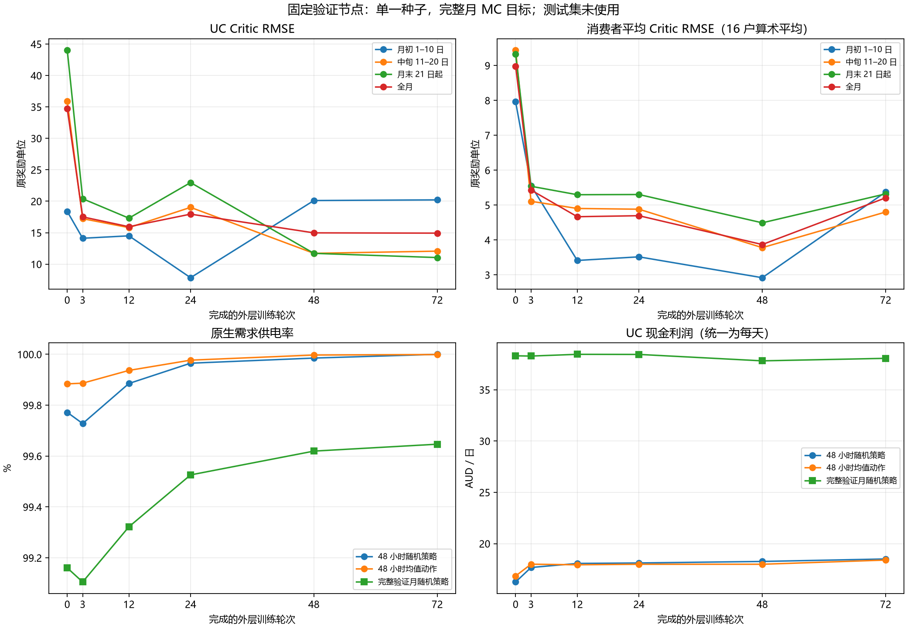
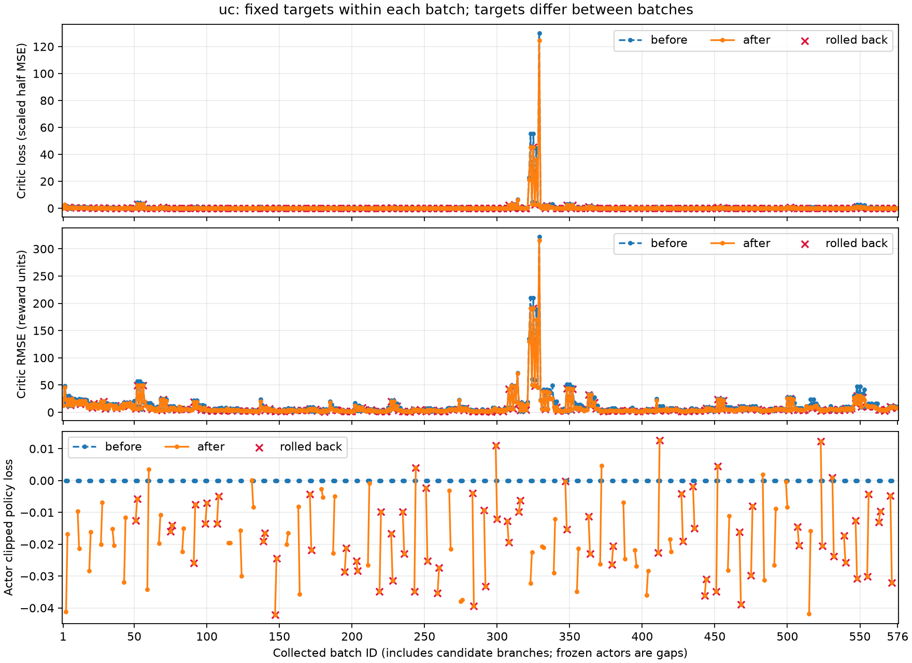
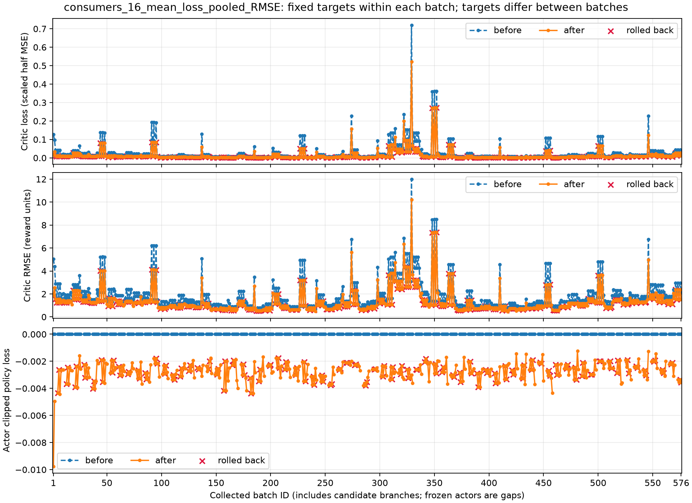

# 72 轮中长期训练与验证

日期：2026-10-20。运行已完成：`outputs/ausgrid-year-study/20261020/`。

**相对第 3 轮基线，最终 UC 全月 RMSE 降低 14.75%，整月失供量减少 61.28%；但 UC 月初 RMSE 上升 43.24%，消费者拟合在第 48 轮之后反弹，整月 UC 现金下降 0.58%。延长训练改善了部分指标，尚不能认定收敛或各日期共同改善。**

## 1. 运行协议与预算

从相同 seed 42 初值执行一次 72 轮训练。UC 六维动作、消费者四维动作、观测、物理模型、奖励和候选选择规则保持不变；本次只延长轮数并完善评价与绘图。没有额外 MC 预拟合、自动补跑或测试集训练／评估。

| 项目 | 实测或设定 |
|---|---|
| 外层轮次 / 真实采样批次 | 72 / 576 |
| 每批时段 / Actor epoch / Critic epoch | 64 / 2 / 4 |
| minibatch / Actor GAE λ / Critic λ | 32 / 0.9025 / 1.0 |
| 全部分支 PPO 时段 / 主轨迹时段 | 36,864 / 18,432 |
| 每个 Critic 实际优化次数 | 4,608，回滚分支照常计数 |
| 训练数据 | 2010-07 至 2011-06，12 个完整月 |
| 主轨迹覆盖 | 384 天、12 次真实月末；训练年循环后停在 2010-07-20 00:00 |
| 冻结验证节点 | 第 0、3、12、24、48、72 轮 |
| 验证数据 | 2011-07、2011-10、2012-01、2012-04 |
| 额外 MC 训练采样 / 测试集使用 | 0 / 未加载、未评估 |

月初启动、批间保留状态、真实月末重置；候选 0 选中 39 次，候选 1 选中 33 次。最终 Adam 保留的 UC Critic 步数为 2,832，每个消费者 Critic 为 2,304；其余实际更新属于回滚分支。UC Actor 保留 264 步，消费者各保留 1,152 步。预算统计与最终保留状态分开记录。

## 2. 全部固定验证节点

| 外层轮次 | UC 全月 RMSE | 消费者平均 RMSE | 完整月供电率 | UC 现金 AUD/日 |
|---:|---:|---:|---:|---:|
| 0 | 34.7406 | 8.9821 | 99.1604% | 38.3107 |
| 3 | 17.5153 | 5.4321 | 99.1051% | 38.2864 |
| 12 | 15.9518 | 4.6678 | 99.3220% | 38.4552 |
| 24 | 17.9515 | 4.6967 | 99.5260% | 38.4460 |
| 48 | 14.9753 | 3.8702 | 99.6195% | 37.8191 |
| 72 | 14.9314 | 5.2078 | 99.6467% | 38.0646 |



以上全部为预先确定的验证节点。最终结果使用第 72 轮，未按结果挑选第 48 轮替代。

## 3. 月初、中旬和月末的 Critic RMSE

| Critic | 日期 | 第 3 轮 | 第 72 轮 | 相对变化 |
|---|---|---:|---:|---:|
| UC | 月初 1–10 日 | 14.1151 | 20.2190 | +43.24% |
| UC | 中旬 11–20 日 | 17.2267 | 12.0651 | -29.96% |
| UC | 月末 21 日起 | 20.3999 | 11.0471 | -45.85% |
| UC | 全月 | 17.5153 | 14.9314 | -14.75% |
| 16 户平均 | 月初 1–10 日 | 5.5582 | 5.3734 | -3.32% |
| 16 户平均 | 中旬 11–20 日 | 5.1092 | 4.8019 | -6.02% |
| 16 户平均 | 月末 21 日起 | 5.5402 | 5.3213 | -3.95% |
| 16 户平均 | 全月 | 5.4321 | 5.2078 | -4.13% |

目标为当前冻结策略的完整月真实终止 MC 回报，按原奖励单位计算。四个月共 5,904 个状态，月初／中旬／月末分别为 1,920／1,920／2,064 个。消费者列为 16 户各自 RMSE 的算术平均，其中 9 户全月 RMSE 改善、7 户上升；逐户数值保留在[机器摘要](results/year_study_20261020/comparison.json)。

## 4. 供电与 UC 收益

| 指标 | 第 3 轮 | 第 72 轮 | 变化 |
|---|---:|---:|---:|
| 完整月供电率（%） | 99.1051 | 99.6467 | +0.5416 |
| 完整月原生失供量（kWh，四个验证月合计） | 234.2880 | 90.7091 | -143.5789 |
| 完整月原生请求量（kWh，四个验证月合计） | 26179.3452 | 25674.0503 | -505.2949 |
| 完整月 UC 现金（AUD/日） | 38.2864 | 38.0646 | -0.2218 |
| 完整月 UC 经营诊断收益（AUD/日） | 32.9746 | 33.1915 | +0.2169 |
| 48 小时随机策略供电率（%） | 99.7279 | 100.0000 | +0.2721 |
| 48 小时随机策略 UC 现金（AUD/48h） | 35.3490 | 37.0106 | +1.6616 |
| 48 小时均值动作供电率（%） | 99.8865 | 99.9991 | +0.1126 |
| 48 小时均值动作 UC 现金（AUD/48h） | 35.9914 | 36.7997 | +0.8083 |

供电率为 `100 × (1 − Σ原生失供量 / Σ原生请求量)`；供电率变化的单位为百分点。四个完整月共 123 天，现金按总金额除以真实天数计算。最终完整月请求量减少 1.93%，绝对失供量减少 61.28%，因此供电改善不只是分母变化。随机策略的短窗口失供为约 `5.4e-16 kWh`，在数值精度下为零；整月仍有 90.7091 kWh 失供。

窗口现金按各月 48 小时金额取平均，完整月现金按总天数加权，不能混用。UC 现金从 38.2864 降至 38.0646 AUD/日，而扣除储能退化和弃电成本后的经营诊断收益略升 0.66%；这些指标也不同于带服务考核与 DR 估值的训练奖励。

## 5. 真实逐批 loss：横轴 1–576

每批在同一固定目标上记录更新前／后的 Critic loss、原单位 RMSE 和实际更新 Actor 的 policy loss。下图保留全部真实点，不按 epoch 聚合、不平滑、不剔除峰值；红叉表示相应网络更新被回滚，冻结 Actor 留空。Critic loss 为缩放后半 MSE；消费者图为 16 户平均 loss 和合并平方误差后开根号的 RMSE。





UC 有 471/576 批的更新后 loss 小于更新前。最初 24 批的更新后平均 loss 为 0.4351，最后 24 批为 0.1179；不同批次的策略、状态与目标不同，这两个均值不能作为同一数据集的收敛检验。第 329 批出现最大 UC 峰值：训练年 2 月、消费者适应阶段，UC Actor 冻结，Critic RMSE 从 322.2835 降至 315.5300。它属于保留主轨迹，不能以候选回滚为理由删掉。

[逐批曲线数据](results/year_study_20261020/batch_curves.csv)含全部 576 个编号、阶段、月份、真实终止和保留标记。全部 17 个网络的原始 JSONL、完整 CSV 和 SVG 在运行目录中保留；Git 仅保存摘要、曲线数据与三张关键 PNG。

## 6. 如何解释本次效果

1. **中旬、月末误差降低，但月初高估仍明显。** UC 月末平均偏差从 −15.3727 降至 −0.9188；月初却从 +8.9315 增至 +18.6183。最终月初平均预测为 31.6942，真实回报平均为 13.0759。整体价值水平的上移改善了后半月低估，同时扩大了月初高估；这与已记录的预测均值和偏差一致。全月解释方差从 0.0701 升至 0.2463，月末解释方差仍只有 0.0123，日期和状态差异的拟合仍不足。
2. **消费者拟合没有持续改善。** 平均 RMSE 从第 48 轮的 3.8702 回升到第 72 轮的 5.2078，最终只比第 3 轮降低 4.13%。Actor、联合响应和采样月份持续变化；在线 Critic 更新和候选回滚不会自动维持早先月份的拟合。该运行没有消融实验，不能把反弹唯一归因于某一个机制。
3. **批内目标与完整月 MC 仍有差别。** `critic_lambda=1` 消除了批内中间旧值的依赖，但普通批末仍用旧 Value。`gamma^64≈0.2763`，靠近批末的状态更依赖尾值；训练 loss 较小并不代表完整月回报已准确。峰值也说明当前运行存在阶段性目标变化。
4. **供电改善与现金增长并非同一目标。** 当前候选按月初 96 步配对折扣奖励选择；该奖励包括服务成本和 DR 估值，既不是整月现金，也没有整轮供电不退化约束。因此可以同时出现短窗口现金上涨、整月供电改善、整月现金略降。第 72 轮已达到预算，未据此追加训练或修改选择规则。

本次是一条 seed 42 训练轨迹，各验证月使用一条冻结随机轨迹，状态相关且策略间轨迹不同；结果衡量各自策略下的拟合和服务表现，不是同一固定样本集的纯回归对照，也不构成总体供电或 Stackelberg–Nash 收敛保证。

## 7. 验证与复现

- 第 3 轮表现和 Critic 统计与已保存的小规模实验精确一致；前 24 条批次记录（包括 loss 和分支处置）也逐条一致。
- 编号连续为 1–576，每批 64 步，候选状态全部已决；主轨迹累计 18,432 步，12 个训练月份均实际覆盖。
- 17 个 Critic 各执行 4,608 次优化；冻结 Actor 与 Adam 隔离检查、候选状态恢复、固定目标复算及物理账本审计通过。
- GAE 最大复算残差 `1.14e-13`，Critic 目标 `2.84e-13`，物理与现金账本残差不超过 `7.11e-15`；完整 checkpoint 的 8 步精确重放通过。
- 算法和环境生产源码与运行启动时哈希一致；源码来源保存在原始报告中。绘图和文档后处理单独修改，不重写历史来源哈希。

以下命令对应历史运行源码 `8509e88`，复现需先在独立历史检出中使用该源码与原数据，输出使用新目录。当前入口已改为三模式和阶段合批协议；直接运行当前入口会得到新的实验。本次没有重新训练。

```python
from experiments.sn_energy_market.batch_critic_pilot import ROOT, run_pilot

run_pilot(
    ROOT / "outputs/ausgrid-year-study/reproduce",
    ROOT / "outputs/ausgrid-batch-critic-pilot/20261020/report.json",
    outer_rounds=72,
)
```

该历史版本默认入口为 3 轮小规模配置。原始 `experiment.json` 绑定启动时源码和学习契约，`validation-XXXX.json` 保存六个节点，`round-XXXX.json` 保存候选选择；`report.json`、`optimizer_steps.json`、`checkpoint/`、`actors/` 与 `batch_losses.jsonl` 均已保存。保留测试集未加载、未评估。
